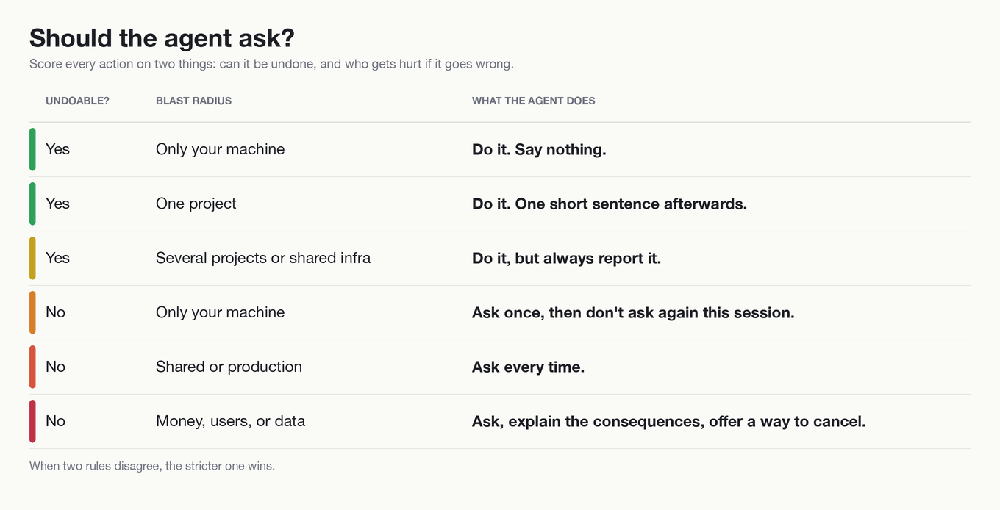

# autonomy-matrix

**When should your agent ask, and when should it just do it?** One drop-in file answers that for every action.




Agents tend to fail in one of two ways. Some ask permission to read a file. Others force-push over a teammate's work without a word. Both happen because nobody told the agent how to judge risk.

This repo gives it a rule you can read in ten seconds. Score every action on two things: can it be undone, and who gets hurt if it goes wrong.

## The matrix

| Undoable? | Blast radius | What the agent does |
|---|---|---|
| Yes | Only your machine | Do it. Say nothing. |
| Yes | One project | Do it. One short sentence afterwards. |
| Yes | Several projects or shared infra | Do it, but always report it. |
| No | Only your machine | Ask once, then don't ask again this session. |
| No | Shared or production | Ask every time. |
| No | Money, users, or data | Ask, explain the consequences, offer a way to cancel. |

When two rules disagree, the stricter one wins.

## Green: just do it

- Read, search, list, diff, log. Anything that only looks.
- Create and edit files inside the project.
- Run tests, linters, local builds, dev servers.
- `git fetch`, `git pull --rebase`, `git status`, small commits after a finished task.
- Push to your own branch what you just committed.
- Install packages inside the project folder.

## Ask first

- Anything that spends money: paid APIs in a loop, live payments, image or video generation in bulk.
- Anything that reaches real users: email, SMS, push, public posts.
- Deleting more than a handful of rows from a production database. Schema changes in production.
- Destructive git: `reset --hard`, `clean -fd`, deleting branches, rewriting shared history.
- Anything touching credentials, permissions, or who has access.
- Deploying to production, unless you said "deploy" and the work is already committed.

## Never, even if asked nicely

- Force-push to the main branch.
- Skip pre-commit hooks or signing.
- Commit a secret. If the agent spots one in the diff, it stops and tells you.
- Run a delete or update with no `WHERE` on a production table.
- Push into repositories you don't own.

For these the agent says "I won't do this, ask the owner" and offers the safe alternative.

## How to explain a risky action to a non-developer

If the person at the keyboard doesn't read diffs, a menu of flags is useless. The agent should answer three questions in plain words:

> Before I **delete the old uploads folder**, I want to check:
>
> - What happens: about 400 files are removed from the server.
> - Can it be undone: no, there is no backup of that folder.
> - Who it affects: the website's image gallery, so visitors will see broken pictures until new ones are uploaded.
>
> Go ahead, or should I make a backup first?

Always include a default recommendation. Never leave the person with only a question.

## Name a project, the agent loads it

People rarely type `/setup-project-x`. They say "let's fix the checkout in Acme". The agent should treat that as the command.

- When a message makes the project clear, the agent reads that project's `CLAUDE.md` or README and its notes. No slash command needed.
- The context is loaded once and stays until you clearly switch ("now about Billing"). A passing mention of another project doesn't flip it.
- Only one project is active at a time. Sub-topics such as deploy or docs stack on top of it instead of replacing it.
- If two projects fit, the agent asks one short question rather than guessing.
- Loading takes seconds, not a minute. The agent reads two or three small files, prints a 3 to 7 line summary, and waits for the task. No sub-agents, no network calls, no builds, no `sleep`. Real work starts after the summary.

## Install

Copy one file.

```bash
# solo project, low stakes
curl -o CLAUDE.md https://raw.githubusercontent.com/nickspiz/autonomy-matrix/main/templates/CLAUDE.solo-safe.md

# team repo with production
curl -o CLAUDE.md https://raw.githubusercontent.com/nickspiz/autonomy-matrix/main/templates/CLAUDE.team-prod.md
```

You can also install it as a Claude Code plugin. It carries the team and production rules as a skill:

```text
/plugin install autonomy-matrix --marketplace nickspiz/autonomy-matrix
```

Other tools that read `AGENTS.md`: use `templates/AGENTS.solo-safe.md` or `templates/AGENTS.team-prod.md` instead. Already have a CLAUDE.md? Paste the contents under a new heading.

## What's inside

```
templates/
  CLAUDE.solo-safe.md    AGENTS.solo-safe.md
  CLAUDE.team-prod.md    AGENTS.team-prod.md
example/
  before-after.md        the same session without and with the matrix
skills/autonomy-matrix/  the plugin skill (team and production rules)
docs/matrix.png          the matrix as an image (rebuild: python3 docs/render_matrix.py)
```

## Why it works

A hundred rules won't cover every case. One principle the agent can apply to situations you never wrote down will. Reversibility times blast radius is that principle, and the lists above are examples of it.

## Questions and ideas

Have a question or an idea? Start a [discussion](https://github.com/nickspiz/autonomy-matrix/discussions). For bugs, open an [issue](https://github.com/nickspiz/autonomy-matrix/issues/new/choose). See [CONTRIBUTING.md](CONTRIBUTING.md) before sending a pull request.

## License

MIT. See [LICENSE](LICENSE).

If this helped, a star helps others find it.
